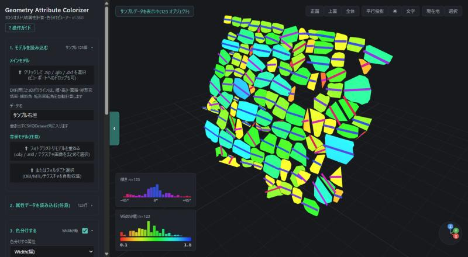
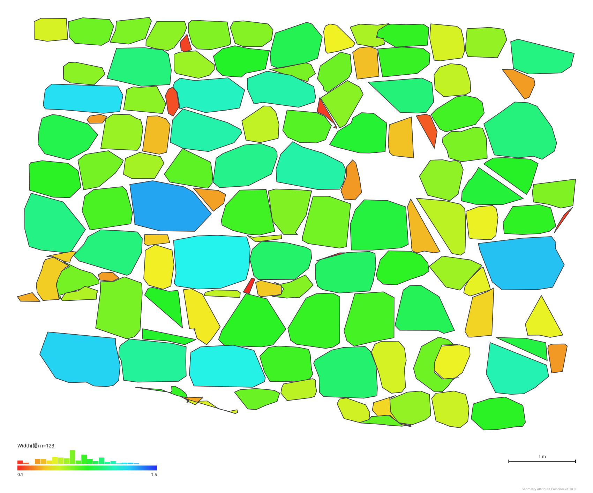

# Geometry Attribute Colorizer

石垣の3D輪郭データ(DXF)を読み込むと、石材1つずつの幅・高さ・面積・傾斜角などを
自動で計算し、選んだ属性に応じて色分けします。色分けした結果は凡例とスケールバーを
付けた立面図SVGとして書き出せるため、報告書の図にそのまま使えます。
ブラウザのみで動作するので、インストールは不要で、読み込んだファイルが
外部へ送信されることもありません。



<sub>開いた直後の画面。大阪城石垣の公開データ123石を、幅で色分けしたもの(出典は下記)。
各石に引いた線は傾きライン(矩形回転角)で、左下にその分布と色分けの凡例が並びます。</sub>

**▶ アプリを開く: https://nabunken-info.github.io/geometry-attribute-colorizer/**

サンプルデータを内蔵しているので、手元にデータが無くても動作を確認できます。

<sub>開発版は <a href="https://reisyu.github.io/geometry-attribute-colorizer/">reisyu.github.io/geometry-attribute-colorizer</a> にあります。
試験中の変更が入るため、現場では上の安定版をお使いください。
開発版を開くと、画面に「開発版」と表示されます。</sub>

## まず動かしてみる

1. 上のリンクを開きます（大阪城石垣のサンプルが表示されます）
2. 「3. 色分けする」で属性を切り替えます（幅・高さ・面積・傾斜角など）
3. 石材をタップすると、その石材の属性が一覧で表示されます
4. 「7. 書き出す」から、立面図SVGやCSVとして保存できます



<sub>書き出した立面図SVG。画面上の色分けがそのまま図になり、凡例には分布の
ヒストグラムとスケールバーが入ります。完全なベクター形式のため、報告書や
Illustratorでそのまま扱えます。</sub>

## 石垣BIMのワークフローでの位置づけ

奈良文化財研究所の[石垣BIMプロジェクト](https://www.nabunken.go.jp/research/stonewallbim.html)では、
フォトグラメトリで作成した3Dモデルを「石垣AIセグメンター」(試験版)で処理し、
石材を1石ずつポリゴン化した3D DXFを出力します。本アプリケーションが読み込むのは
この形式です。

```
3D計測(フォトグラメトリ)        Metashape 等
    ↓
AIによる自動セグメンテーション    石垣AIセグメンター(試験版)
    ↓  1石ずつポリゴン化した3D DXF
属性の計算・色分け・図化          ← このアプリ(ブラウザのみ)
```

属性の計算から色分け、報告書用の図の書き出しまでを、専用ソフトウェアを
導入せずにブラウザ上で行えます。タブレットでも動作するため、現場にそのまま
持ち出せます。

## 機能の一覧

<details>
<summary>すべての機能を開く（長いので畳んであります）</summary>

### 読み込みと属性計算
- **DXF(閉じたポリライン)の読み込みと属性の自動計算**
  - **LWPOLYLINE / POLYLINE の両形式に対応**。AutoCAD・QGIS・Illustrator等が
    書き出す一般的なDXFも、クラスタリングソフトやRhinoの出力もそのまま読めます
  - 最適フィット平面への投影(輪郭が完全な平面でなくてもOK)
  - 最小外接矩形を回転キャリパー法で厳密に計算
  - 大規模データ(1万輪郭規模)もプログレスバー表示で快適に処理
  - 平面直角座標系などの大きな座標は自動で原点シフト(表示精度の確保)
- **GLB(glTF 2.0バイナリ)の3D表示** — 回転・パン・ズームで閲覧
- **CSV属性との自動マッチング** — CSVのID列とオブジェクト名を突き合わせて属性を紐づけ
- **フォトグラメトリモデルの重ね表示** — OBJ + MTL + テクスチャ画像を読み込み、
  輪郭・色分けを実物のテクスチャモデルに重ねて表示。**輪郭モデルが常に写真より手前**に
  描かれ、輪郭モデルの不透明度(既定65%)を下げると下の写真が透けて見えます。
  **フォルダごと選択**すれば一式が自動収集されます。
  テクスチャは自動で縮小(最大2048px)されるため、大容量データでも安定して動作
- **IDの自動採番** — DXF読み込み時、立面図で左下のオブジェクトから順に
  1, 2, 3... と自動で採番(下の段から、段内は左から右)。
  元のIDはSrcID属性として保持されるため、元データとの照合も可能。
  段(コース)番号もCourse属性として保存され、段ごとの色分け・フィルタに使えます

### 色分け
- **属性による色分け** — 数値属性はグラデーション、テキスト属性はカテゴリ別カラーで自動判定
- **配色プリセット** — 赤→青 / 赤→緑 / 黄→青 / グレースケール / カスタム(3色グラデーション対応)
- **カテゴリ色** — テキスト属性は識別性の高い20色+自動生成で何種類でも色分け可能。
  「上位7カテゴリのみ色分け(残りはその他)」オプションで、種類が多い属性も読みやすく表示
- **傾きライン** — 各オブジェクトの外接矩形の水平軸に沿った中心線を、
  矩形回転角に応じた色(0°=青 / ±22.5°=マゼンタ / ±45°=赤。3色とも変更可)と
  太さ(20〜100mm実寸)で描画。線が水平に揃っていれば整った積み方、
  乱れていればランダムな積み方だと読み取れます。
  **中間の色を別に持たせている**のは、2色だけで混ぜると中間が灰色がかって
  下地の石より暗くなり、いちばん読みたい中間の傾きが見えにくくなるためです
- **畳んだままオンオフできます** — ステップ3〜6(色分け・傾きライン・フィルタ・
  ラベル)は、見出しの右端のチェックで切り替えられます。現場で左パネルを
  畳んで3D表示を広げていても、開き直さずに済みます
- **グラデーションの反転** — チェック1つで色の向きを逆転
- **範囲の手動指定** — グラデーションの最小値・最大値を固定(外れ値対策、モデル間の基準統一)。
  **指定した範囲は属性ごとに保持**されるため、属性を切り替えて戻っても設定が残ります。
  **既定でオン**なので、誰が開いても同じ配色になり、書き出した図を並べて比較できます
  (データに合わせたい場合はチェックを外してください)
- **範囲の初期値** — よく使う属性には初期値が入っています(幅・高さ0.1〜1.5、
  面積0.05〜1、矩形充填率0.5〜0.9、アスペクト比0.25〜4、傾斜角30〜90、矩形回転角-45〜45)。
  毎回同じ基準で色を描けるので、別の壁面と見比べるときに色の意味が揃います。
  データが初期値を大きく超えて範囲が成立しない場合は、どうするかを尋ねるダイアログが出ます
  (設定が勝手に変わることはありません)
- **設定の即時反映** — 一度色分けを実行した後は、配色・範囲などの変更が即座に反映
- **凡例 + ヒストグラム** — グラデーションバーの上に分布ヒストグラムを表示。
  各ビンは実際の色分けと同じ色で塗られ、どの色の石が何個あるかが一目で分かる
- **フィルタ** — 任意の数値属性に**残す範囲**(複数可)を決めて絞り込み。
  自己交差の大きさでも除外できます。除外した石は半透明または非表示で表現。
  **色分けをしていなくても使えます**(形だけを絞り込んで見たいとき)
- **おすすめフィルタ設定** — 調査でよく使う3条件(面積0.05以上 / アスペクト比0.25〜4 /
  傾斜角30以上)をボタン1つで適用。小さすぎる破片・極端に細長い形・水平に近い面を除きます
- **傾きラインは最初から表示されます** — 不要なときはチェックを外せます。
  出せないデータのときは自動で外れます
- **傾きの分布** — 傾きラインを表示すると、ビューの左下に傾き角(-45〜+45°)の
  ヒストグラムが凡例と並んで出ます。色は線と同じなので、図と見比べて左右どちらに
  偏っているかを読めます。別の属性で色分けしていても同時に見られ、
  **立面図SVGにもそのまま入ります**

### 手で値を付ける(分類)

- **未保存であることを3箇所で示す** — ビュー左上のバッジ、ステップ7の見出しの件数、
  CSV保存ボタンの強調。書き出すまで消えません。閉じようとすると確認も出ます
- **ブラウザへの自動保存と復元** — 入力した値は自動で控えられ、同じデータを
  読み込み直すと復元を提案します。控えは同じブラウザの中だけの一時的なもので、
  確実に残すにはCSVで保存してください
- **読み戻しは元ID(`SrcID`)で照合** — DXFを作り直すと表示上のIDは振り直されますが、
  手入力した内容は元のオブジェクトに付いたままになります。IDがずれていた場合はその旨を通知します
- **属性と点検項目は別のものとして扱われます** — 石種・エリアのような
  **石そのものの性質**は1石に1つで台帳に、はらみ出し・ひび割れのような
  **点検のたびに見る項目**は調査日・調査者ごとの記録に入ります。
  作るメニューが別なので、どちらかを選ぶ操作は要りません
- **分類を付ける(石種・エリアなど)** — 計算では出せない分類を手で付けられます。
  ステップ2で分類の列を作り、選んだオブジェクトにビュー上のパネルから値を付けます。
  **選択肢は事前に決めません**。その列で使われている値がそのまま候補になり、
  新しい値は入力した瞬間に候補に加わります(語彙はCSVに入るので、前回のCSVを
  読み込めば戻ります)。表記ゆれは後から統合できます。
  **未入力は灰色**で表示されるので、塗り残しが一目で分かります
- **手入力した値は未保存の警告と自動控えの対象** — 計算し直せないデータなので、
  同じ仕組みで守られます
- **列は一覧で並び、切り替えずに入力できます** — 作った列が縦に並ぶので、
  石を選んだまま別の列へ続けて値を付けられます。
  **点灯しているチップをもう一度押すと外れます**(チェックのように使えます)

現場で所見を書き留める機能は開発中の扱いのため、末尾の
[開発中の機能](#開発中の機能) にまとめています。

### 表示・確認
- **クリックで属性表示** — オブジェクトをクリック(タップ)すると属性一覧を表示。
  選択したオブジェクトはオレンジの輪郭でハイライトされます
  (画面上の太さで3px固定。ズームしても太さは変わりません)
- **現在地の目安表示(位置情報モード)** — ビュー右上の「現在地」で入り切りします。
  ONの間は俯瞰図が出て、**歩くとマーカーが追いかけます**。
  平面直角座標系は自動判定(19系 × 軸の並びから選ぶ)。**精度円を必ず一緒に描く**ので、
  誤差の大きさがそのまま見えます。石の特定には使えません(GPSの誤差は現地で20〜50m)。
  判定できないときは何も表示しません。位置は外部に送らず、CSVにも記録しません。
  **視点は勝手に動きません**(「近くの区画を見る」を押したときだけ移動)。
  OFFにすると測位を止めます(電池のため)。
  **オンラインで開いた場合のみ**(オフライン版ではブラウザが位置情報を許可しません)
- **いま画面に映っている石が、俯瞰図で光ります** — 「自分が立っている場所」と
  「いま編集しようとしている場所」がずれていないかを、自分の目で確かめられます。
  誤差20mでは隣の区画を掴んでいることがあり、それに気づかないまま分類やメモを
  書き込むのがいちばん困るためです
- **まとめて選ぶ(ブラシ)** — 選択モードでなぞると複数のオブジェクトを選べます。
  「孕み出している一角」のように数値では絞り込めないまとまりを選び、
  **まとめてメモや分類を付ける**ためのものです。選んでいないものは薄くなり、
  範囲が一目で分かります。1回のなぞり単位で取り消せます
- **視点プリセット** — 「正面」(立面図SVGと同じ向き)・「上面」・「全体」ボタンでワンクリック移動
- **平行投影への切り替え** — 透視投影(既定)⇄平行投影(パースなし)をワンクリックで切り替え。
  向き・ズームは保ったまま切り替わる。「現在のビューをSVGで保存」の書き出し結果にも連動する
- **軸ギズモ・投影方式インジケータ** — ビュー右下に、元データのX/Y/Z軸が現在どちらを
  向いているかを表示。平行投影に切り替えている間はラベルでも明示
- **ダーク / ライトテーマ** — ビュー右上のボタンで背景色を切り替え(投影・印刷向け)
- **文字の大きさ** — ビュー右上の「文字」で**標準 / 大 / 特大**を切り替え。
  文字に合わせてパネルの幅も広がります。次に開いたときも覚えています。
  タブレットで読みづらいという声に応えたもので、**ブラウザのピンチ拡大に頼らずに済みます**
  (拡大したままビューを操作すると、画面は大きいのにビューだけ縮んで分からなくなります)
- **ラベル表示** — 各オブジェクトの位置にIDや属性値を常時表示
  (複数属性の同時表示、文字サイズ調整、遠いラベルの自動非表示)

### 書き出し
- **書き出しファイル名にデータ名が付く** — 「データ名」を設定しておくと
  `本丸東面_2026調査_elevation.svg` のように先頭に付与され、複数の壁面を扱っても
  ダウンロードフォルダで区別できます
- **CSV書き出し** — 自動計算した属性(または読み込んだ属性)をCSVとして保存。
  「データ名」を設定しておくと全行にDataset列として付与され、複数の調査データを
  BIツールやPython(pandas)で結合したときの由来識別に使えます
- **ID付きGLB書き出し** — オブジェクト名(ID)を保持したGLBを書き出し。
  法線の向きは壁全体で自動的に統一されます。
  Blender・Rhinoなど他ツールでの再利用が可能(DXF→GLB変換としても使えます)
- **立面図SVG書き出し** — モデルの正面から見た平行投影の立面図を、
  完全なベクター(SVG)として書き出し。含める要素(凡例・スケールバー・ラベル・傾きライン)を
  選択でき、輪郭線の太さ(mm実寸)指定や、塗りつぶしなしの線画モードにも対応。
  Illustrator等で後編集できます
- **現在のビューSVG書き出し** — 立面図とは別に、現在のカメラの向き・ズームをそのまま使って
  ベクター書き出し。透視投影ならパースあり、平行投影ならパースなしで出力されます。
  凡例・ラベル・傾きラインの設定は立面図と共通。縮尺が一定とは限らないためスケールバーは非対応
- **まとめてZIPで保存** — チェックした属性ごとの立面図SVGを一度に書き出し、
  ZIP 1つにまとめて保存。色分けをしない「傾きラインの線画」も含められます。
  **色分けの図には傾きラインを重ねません**(線画は別の1枚にまとめるため)。
  向きと縮尺が揃うので、報告書に並べて比較できます。
  外部ライブラリを使わずブラウザ標準の圧縮機能で作っています
- **iPad・スマホでは「送る」になる** — 指で操作する端末では書き出しボタンが
  「〜で送る」になり、押すと**共有シート**が開きます。メール・チャット・AirDropに
  その場で渡せるので、ファイルAppを開いて探す手間がありません
  (シートの「ファイルに保存」で端末に残すこともできます)。
  送らずに閉じた場合、メモ・分類の**未保存の表示は消えません**。
  まとめてZIPだけは、作るのに数秒かかるため「作る」→「送る」の2回押しです。
  パソコンではこれまでどおり保存(ダウンロード)します

</details>

## 自動計算される属性(DXF読み込み時)

| 属性名 | 日本語名 | 内容 |
|---|---|---|
| Width | 幅 | 最小外接矩形の2辺のうち、水平に近い方の辺の長さ |
| Height | 高さ | 最小外接矩形の2辺のうち、鉛直に近い方の辺の長さ |
| Area | 面積 | フィット平面に投影した輪郭の面積 |
| FillRate | 矩形充填率 | 輪郭の面積 ÷ 外接矩形の面積(1に近いほど矩形に近い形) |
| Aspect | アスペクト比 | 幅 ÷ 高さ。1より大きいほど横長、小さいほど縦長。1に近いほど正方形に近い |
| Tilt | 傾斜角 | 面の法線と鉛直(+Z)のなす角。0°=水平な面、90°=垂直な面 |
| RectAngle | 矩形回転角 | 外接矩形の水平辺が面内の水平基準から回転している角度。反時計回り(右上がり)がプラス、±45°の範囲 |
| Flatness | 平面性 | フィット平面からの最大ズレ距離。大きいほど平面近似の信頼性が低い |
| SelfIntersect | 自己交差 | 輪郭の自己交差の大きさ（0〜0.5）。0は交差なし。Areaはこの値の2倍だけ小さく出る |
| X / Y / Z | 重心座標 | 輪郭重心の座標(原点シフト前の元の値)。Zで色分けすると標高表示になる |
| SrcID | 元ID | 読み込み時のレイヤー名由来のID(自動採番で振り直される前の値) |
| Course | 段 | 立面図で下から数えた段(コース)番号 |

アプリ内では `Width(幅)` のように英語名+日本語名が併記され、
属性を選ぶと定義の説明が表示されます。

## サンプルデータ

- アプリを開くと、内蔵の石垣サンプル(123石)が自動で表示されます
- リポジトリの [`sample_ishigaki.dxf`](./sample_ishigaki.dxf) をダウンロードして
  読み込めば、DXFワークフロー(自動属性計算・原点シフト)を試せます

### 出典

同梱の `sample_ishigaki.dxf` および内蔵サンプルは、奈良文化財研究所
[石垣BIMプロジェクト](https://www.nabunken.go.jp/research/stonewallbim.html)が公開している
「**サンプルデータ(大阪城石垣3Dモデル)**」を**石垣AIセグメンター(試験版) v1.3**で
処理し、一部(123石)を抜き出して座標を原点付近へ移動したものです。

**自由に利用してよい**ことを出典元に確認しています（2026年10月）。

なお、このデータは**本ソフトウェアのMIT Licenseの対象ではありません**。
著作権はソフトウェアとは別に、出典元にあります。

## 使い方

### DXFから始める場合(属性を自動計算)

1. **DXFファイルを読み込む** — ビューポートにドラッグ&ドロップ(またはパネルから選択)
2. 属性が自動計算され、そのまま色分け表示されます(手順2のCSV読み込みは不要)
3. 「3. 色分けする」で対象属性・配色・範囲を調整(変更は即座に反映)
4. 「7. 書き出す」からCSVやID付きGLB、SVGとして保存できます

### フォトグラメトリモデルを重ねる場合

1. **先にDXFを読み込む**(原点シフト量がここで決まり、背景と位置が揃います)
2. 「フォトグラメトリモデルを重ねる」から **.obj / .mtl / テクスチャ画像を
   すべてまとめて選択**(ビューポートに一式まとめてドロップも可)
3. 読み込み後、**輪郭モデルの不透明度**スライダーで、写真の透け具合を調整できます
   (輪郭モデルは常に写真より手前に描かれます)
4. 背景は表示専用です(クリック判定・色分け・書き出しの対象にはなりません)

### GLB + CSVから始める場合

1. **GLBファイルを読み込む** — ビューポートにドラッグ&ドロップ
2. **CSVファイルを読み込む** — ID列を確認
3. **色分けを実行** — 属性と配色を選ぶ

### ビューポートの操作

| 操作 | 動作 |
|---|---|
| 左ドラッグ / 1本指ドラッグ | 回転(画面中央に見えているものを中心に回ります) |
| 右ドラッグ / Shift+ドラッグ / 2本指ドラッグ | パン(平行移動) |
| ホイール / 2本指ピンチ | ズーム(マウスカーソルの位置を中心に拡大縮小) |
| クリック / タップ | オブジェクトの属性を表示 |
| ダブルクリック / ダブルタップ | その位置を回転中心に設定 |

iPad等のタッチデバイスにも対応しています。

**左パネルは閉じられます**(3D表示の左端のつまみ)。読み込みと色分けが済んだ後の現場作業では
3D表示を広げたほうが見やすく、iPad縦で468→768pxまで広がります。閉じている間、
アプリからの知らせは画面左上に出ます。

**選択モード**(ビュー右上の「選択」、Escで解除)に切り替えると、左ドラッグ(1本指)が
**なぞって複数を選ぶブラシ**になります。パンとズームは通常モードと同じまま使えます。
回転は通常モードでのみ行えます。**モードを抜けると選択は解除される**ので、
値やメモを付けてから抜けてください。

### 色分けのヒント

- **RectAngle(矩形回転角)** は初期値が -45 〜 +45 に設定済みです。
  これに加えてカスタム配色で赤→白→青の3色(「中間色を使う」をオン)にすると、
  左傾き=赤 / 水平=白 / 右傾き=青 という直感的な表現になります
- 外れ値で色が潰れるときは「範囲を手動で指定」で範囲を絞ってください

## データの準備方法

### DXFファイル(石垣輪郭などの場合)

- **閉じたポリライン**で構成されている必要があります。以下の形式に対応しています。
  - **LWPOLYLINE** — AutoCAD・QGIS・Illustratorなど、一般的なCAD/GISツールが
    既定で書き出す形式。標高(elevation)はZ座標として読み込まれます
  - **POLYLINE / VERTEX** — 閉じた3Dポリライン(クラスタリングソフトの出力形式)。
    **Rhino等が書き出す2Dポリラインにも対応**
  - 傾いた座標系(OCS)は自動でワールド座標に変換されます
  - 円弧(バルジ)を含むポリラインは、円弧部分を直線として読み込みます
    (読み込み時に件数を通知します)
- 線分(LINE)・スプライン(SPLINE)・円のみのファイルは読み込めません。
  CADでポリラインに変換してから書き出してください
- 1つの輪郭 = 1つのオブジェクトとして扱われます
- **レイヤー名の末尾の数字がIDになります**(例: `Layer123` → ID `123`)
- 輪郭は完全な平面である必要はありません(最適フィット平面に投影して計算します)
- Z軸が鉛直(上方向)、XY平面が水平であることを前提に、幅・高さ・傾斜角・回転角を判定します

### OBJファイル(フォトグラメトリモデル)

- .obj / .mtl / テクスチャ画像(PNG/JPG)を**同時にまとめて選択**してください
  (MTL内のテクスチャ参照は、ファイル名で自動的に対応づけられます)
- 座標系はDXFと同じ(Z軸が鉛直、平面直角座標系などの実座標)を想定しています
- テクスチャは読み込み時に最大2048pxへ自動縮小されます

### GLBファイル

- **glTF 2.0のバイナリ形式(.glb)** に対応(.gltf + .bin の分離形式は非対応)
- **オブジェクト名がCSVのIDと一致している必要があります**
  - `Cell_1` のような接頭辞付きの場合は「オブジェクト名の接頭辞」欄に指定

### CSVファイル

- 1行目はヘッダー(列名)、ID列+任意の数の属性列
- 属性は数値・テキストのどちらでも扱えます(自動判定)

```csv
ID,Area,Width,Height
1,0.113581,0.52,0.31
2,0.246072,0.68,0.45
```

## 想定ワークフロー(石垣調査の例)

1. 石垣をフォトグラメトリで3Dモデル化
2. クラスタリングで各石の輪郭を抽出し、DXFとして書き出し
3. **本アプリにDXFを読み込むと、各石の幅・高さ・面積・矩形充填率・傾斜角・
   矩形回転角が自動計算され、属性に応じて色分け表示される**
4. 石種・エリアなどの分類を、ブラシで選んでまとめて書き込む
5. 必要に応じてCSVやID付きGLBで書き出し、他ツールで分析・再利用
   (手入力した内容もCSVに入り、次回そのCSVを読み込めば戻る)

現場での点検記録を重ねる運用は、[開発中の機能](#開発中の機能) に記しています。

## 設定の保存

見た目の設定(背景モデルと輪郭モデルの不透明度、傾きラインの色と太さ、
ラベルの文字サイズ、SVG書き出しで含める要素、ライト/ダーク、投影方式など)は、
**次に開いたときも引き継がれます**。

**色分けの設定(配色・範囲・反転)は引き継ぎません。**
誰が開いても同じ配色になるようにするためです。

設定はそのブラウザの中だけに保存され、外部に送信されることはありません。

## プライバシーについて

読み込んだファイルは**すべて利用者のブラウザ内だけで処理**されます。
外部サーバーに送信されることはありません。

## 動作環境

- モダンブラウザ(Chrome / Edge / Firefox / Safari の最新版)
- iPad / タブレット対応(タッチ操作・ファイル選択)
- WebGL対応環境
- 初回の読み込みにインターネット接続が必要です(3D表示とCSV解析のライブラリを
  CDNから取得するため)。読み込めなかった場合は、その旨と対処を画面に表示します

### ネットワークが使えない場所で使う場合

**`build_offline.bat` をダブルクリック**（または `node tools/build_offline.js`）すると、
ライブラリを本体に埋め込んだ
**単一HTMLファイル**が `dist/` に作られます。操作ガイドと練習用DXFも一緒に
出力されるので、フォルダごとUSBメモリ等で配れば、ネットワーク無しで動作します
(講習会など向け)。

`dist/` の中身は、アプリ本体・[1枚手順書](./quickstart.html)(A4縦・印刷用)・
操作ガイド・練習用DXF・最初に読む案内テキストです。

## 開発中の機能

ここに挙げるのは現場での点検記録にかかわる機能で、**まだ開発中の扱い**です。
2026年10月に城郭石垣の管理を担当されている方へ現地で試用していただき、
そこで分かったことを反映している段階のため、画面の構成や点検データ(ZIP)の
中身は今後も変わります。以前の版で書き出したZIP・GLBは読み込めるように
していますが、試される際は記録のCSVを別に保存しておいてください。

- **メモ欄** — オブジェクトを選ぶと属性インスペクタにメモ欄が出ます。点検の所見などを
  書き留めると、CSVの `Note` 列として書き出されます。
  **メモだけは計算し直せないデータ**なので、扱いを他の属性と分けています
- **書いた石は、その場で色が変わります** — 点検データを開くと
  `履歴:記録の状況` で色分けされた状態で始まり、メモを書いた石から色が変わります。
  **赤**=前回の指摘で今回まだ書いていない / **青**=前回の指摘を見て書いた /
  **橙**=今回あらたに書いた / **グレー**=記録なし。
  赤が無くなれば、前回の指摘はひととおり回り終えたことになります。
  初回の点検では橙とグレーの2色です。
  メモ本文はラベルにも出せます(長いものは先頭だけ表示)
- **前回までの記録を「参考」として重ねられます** — 前回の調査で書き出したCSVを
  読み込むと「前回:」の付いた列が増え、石を選ぶとメモ欄の上に前回の記述が出ます。
  **「履歴:記録の状況」で色分けすれば、前回メモの付いた石が赤くなる**ので、
  今回追うべき石が図の上で一目で分かります。書くと青に変わるので、
  **どこまで回ったかも同じ図で分かります**。編集はできず、**書き出すCSVにも入りません**
  （記録として残すのは今回の分だけ）。前回と今回でIDが変わらないことが前提なので、
  一度「ID付きGLB」を書き出し、以後それを台紙として使う運用になります
- **点検データをZIP 1つで持ち運べます** — モデル・属性・記録をまとめて保存し、
  次の点検はそのZIPを開くだけ。**同じ日に開き直しても書いた内容は消えず**、
  日付が変われば前の回が自動的に「前回」になります。
  記録は「1オブジェクト×1調査日×1調査者＝1行」なので、
  **複数人のZIPから記録CSVを集めて1つのZIPに入れれば、開くだけで統合されます**
  （同じ石に2人が書いていれば両方残ります）。記録に入るのは何か書いた石だけです
- **属性パネルは「属性」と「調査」のタブに分かれます** — 現場で使う調査タブには
  調査日・調査者・分類・これまでの記述・メモ欄がまとまっています。
  最後に開いていたほうを次も開くので、現場と机の上での使い分けがそのまま残ります
- **何度も指摘されている石が図に浮かびます** — 記録がたまると
  `履歴:記録回数` と `履歴:最終記録日` で色分けできます。
  **一度も記録が無い石はグレー**になるので、記録のある石だけが色付きで残ります。
  前回だけを見ていては出てこない情報で、経年で追う意味そのものです
- **誰がどこを見たかが分かります** — 持ち寄って統合したあと、
  `履歴:調査者` で色分けすると**分担どおりに回れたか**が図になります。
  同じ石に2人が書いていれば「佐藤・山田」のように並びます
- **点検データ(ZIP)からもSVGを書き出せます** — 現場で記録したそのままの状態から
  報告書用の図を出せます。DXFを読み直す必要はありません
  (読み直すとIDが振り直され、それまでの記録との対応が切れます)

記録すると、CSVに次の列が加わります。

| 属性名 | 日本語名 | 内容 |
|---|---|---|
| Note | メモ | 画面で記入した所見。書き込んだときだけ列が付く |
| HasNote | メモの有無 | メモが書かれていれば「あり」、空なら「なし」。メモ本文から自動生成 |

## 制限事項

本アプリケーションは測量機器ではありません。計算に用いるのは読み込んだデータ
そのものであり、元の3Dモデルの精度を超える結果は得られません。そのうえで、
以下の点に留意してください。

- **現在地から石材を特定することはできません。** GPSの誤差は現地で20〜50mあり、
  点だけを示すと誤解を招くため、精度円を併せて描いています。円が壁面の半分を
  覆っていれば、それが誤差の大きさです。座標系を判定できない場合は、推測で位置を
  示さず、その理由を表示します
- **自己交差のある輪郭は、面積が小さく算出されます。** 交差の大きさを
  `SelfIntersect` に出力しているので、値が付いている石材では面積をそのまま
  用いないでください。面積はこの値の2倍だけ小さく算出されます
- **`Flatness` が大きい石材では、幅・高さ・面積の信頼性が下がります。**
  これらは最適フィット平面へ投影して求めるため、平面から離れた形状ほど
  実際の寸法からずれます
- **円弧(バルジ)は直線として読み込みます。** 形状がわずかに変わるため、
  該当する輪郭の件数を読み込み時に表示します
- **メモと分類は、保存しなければ残りません。** ブラウザ内に自動で控えますが
  一時的な控えに過ぎないため、点検データ(ZIP)またはCSVとして保存してください

本アプリケーションは MIT License のとおり無保証であり、これを用いた判断や成果に
ついて作者は責任を負いません。文化財の保存や修理にかかわる判断は、現地での確認と
専門家の判断を経て行ってください。

## 開発について

作者が [Claude](https://claude.ai/code)（Anthropic）の支援を受けて開発しました。
コミット履歴に共著者として残っています。

設計上の判断とその根拠は [SPECIFICATION.md](./SPECIFICATION.md) に、過去に生じた
不具合とその類型は [CLAUDE.md](./CLAUDE.md) に記録しています。採用しなかった案と
その理由も併せて残してあります。

動作は Node.js によるテスト648件と、ブラウザでの実機確認によって検証しています。

## ライセンス

MIT License — 詳細は [LICENSE](./LICENSE) を参照してください。

## 使用ライブラリ

- [Three.js](https://threejs.org/) (MIT License) — 3D表示
- [PapaParse](https://www.papaparse.com/) (MIT License) — CSVパース
